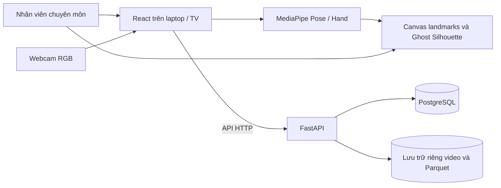

# Kiến trúc phục hồi chức năng chi trên

## Quy trình nghiệp vụ

Năm phân hệ chính là Tổng quan, Đánh giá, Luyện tập, Báo cáo, Quản trị. Các trang phiên, camera, game và kết quả là màn hình con. Router giữ các URL nghiên cứu cũ để tương thích dữ liệu, thiết bị và kiểm thử; không thêm chúng vào menu chính.

Frontend dùng `services/rehab.ts` và `types/rehab.ts` cho API nghiệp vụ. Assessment quản lý từng lần khám, snapshot câu hỏi và lựa chọn nhiều bài. Training tìm chính xác mã inpatient và giữ một session qua nhiều trial. `ClinicalWorkspace` giữ nguyên một `WorkspacePage` được mount từ setup đến kết quả/dashboard; đổi game chỉ tạo trial mới. Chỉ kết thúc hoặc rời quy trình mới unmount camera/models. Cấu hình camera có revision và callback để phản hồi lưu chậm không xác nhận nhầm cấu hình đã thay đổi.

Backend chia module theo domain: `workflow_patients` (transaction chuyển nhóm), `questionnaires` (phiên bản/snapshot/answers), `workflow_catalog` (danh mục/chỉ định), `workflow_sessions` (đánh giá/luyện tập/trials), `workflow_reports` (thống kê và báo cáo thật). `workflow_common` chứa invariant và khóa hàng dùng chung với các API tương thích trong `main.py`. Các bản ghi mới qua quy trình có `managed_workflow=true`; dữ liệu nghiên cứu cũ giữ nguyên định dạng. API tạo luyện tập cũ cũng gọi service mới và chặn outpatient.

Một `patients` chứa hai nhóm, không có bảng bệnh nhân sao chép. `patient_transfers` tham chiếu session đánh giá đã hoàn thành làm Baseline; kết quả không được sao chép hoặc di chuyển. Session lưu assessment/training và bốn trạng thái draft/in_progress/completed/cancelled. Questionnaire submission giữ snapshot câu hỏi; một thay đổi phiên bản không sửa lịch sử.

Mỗi lần chơi tạo trial trước khi chạy. `client_round_id` bảo vệ retry tạo trial; `round_id` bảo vệ retry lưu kết quả. Session lock tuần tự hóa bắt đầu, lưu, invalidation và hoàn tất. Việc chuyển nhóm khóa bệnh nhân và ghi patient/transfer/Baseline/audit trong một transaction; lỗi rollback toàn bộ. Khóa được đọc lại để tránh identity-map cũ sau yêu cầu đồng thời.

Chi tiết dữ liệu và API trong [DATABASE](DATABASE.md); bằng chứng thực chạy và giới hạn trong [IMPLEMENTATION_REPORT](IMPLEMENTATION_REPORT.md).

## Phạm vi

Ứng dụng hỗ trợ nghiên cứu với mã bệnh nhân giả danh, phiên tập và hiệu chuẩn thủ công bằng hình bóng tham chiếu. Webcam RGB đặt giữa cạnh trên TV; laptop chạy ứng dụng và xuất hình lên TV. Hình bóng giúp nhân viên chuyên môn căn vị trí đầu, vai và thân, nhưng không phải công cụ tự xác nhận tư thế đạt chuẩn lâm sàng. Cần hiệu chuẩn lại khi ghế hoặc camera thay đổi.

Căn cứ phạm vi nghiên cứu: tài liệu `Rehabilitation - đề cương nghiên cứu - 26.10.docx` và sơ đồ pipeline do người yêu cầu cung cấp. Nội dung dưới đây phân biệt phần MVP với luồng dự kiến ở giai đoạn sau.

Frontend xử lý hình ảnh camera tại trình duyệt. Canvas phủ lên video; cấu hình hình bóng có tọa độ chuẩn hóa để phục vụ các kích thước hiển thị khác nhau. Trò Chạm hoa phát sáng dùng mốc cổ tay bên tập để nhận chạm, tạm dừng đồng hồ khi mất mốc và có thể lưu kết quả vào phiên đang thực hiện. API quản lý bệnh nhân, phiên, hiệu chuẩn và kết quả trò chơi; PostgreSQL là nguồn dữ liệu ứng dụng và không dùng SQLite. Chế độ demo dùng con trỏ mô phỏng, không ghi kết quả thành dữ liệu bệnh nhân.

## Luồng thu thập thử nghiệm

Camera hoặc video cục bộ đưa frame vào MediaPipe trong trình duyệt; kết quả thô và dữ liệu frame được gửi theo batch về backend, tách biệt overlay. Video webcam được mã hóa bằng MediaRecorder từ luồng camera; video replay được nhận diện là nguồn đã quay. Backend quản lý metadata capture trong PostgreSQL và file nghiên cứu ở vùng riêng, không phục vụ static. Capture nối bệnh nhân, phiên và trial với các artifact bằng capture ID. Chi tiết về thời gian, schema, consent, kiểm tra dữ liệu và giới hạn tại [DATA_COLLECTION](DATA_COLLECTION.md) và [DATA_DICTIONARY](DATA_DICTIONARY.md). Việc hiện diện của code không thay thế kiểm thử end-to-end trên môi trường mục tiêu.

## Luồng nghiên cứu dự kiến sau MVP

Sơ đồ đề cương mô tả camera tạo luồng mốc vận động qua MediaPipe và một nhánh video theo thời gian. Mốc được dùng cho trò chơi AR và đặc trưng chuyển động; kết quả bài tập, đặc trưng, video và đánh giá lâm sàng là các nguồn có thể đưa vào AI về sau. AI có thể hỗ trợ ước lượng mức suy giảm và đề xuất bài tập, với nhân viên chuyên môn xác nhận. MVP có trò Chạm hoa thử nghiệm; chưa triển khai dự đoán AI hoặc cá nhân hóa bài tập.

Điểm FMA-UE do nhân viên chuyên môn đánh giá là nhãn tham chiếu, tối đa 66 điểm. Điểm trò chơi không phải FMA-UE. Không suy luận lực, sức cơ, co cứng hoặc đưa ra kết luận lâm sàng chỉ từ webcam. Video trong nghiên cứu tương lai chỉ được ghi khi có sự đồng ý và phải có biện pháp bảo vệ và kiểm soát truy cập.

Đồng bộ dữ liệu nghiên cứu cần bảo toàn `frame_id`, `timestamp_ms`, `patient_id`, `session_id`, `trial_id`, metadata và validity, đồng thời phân biệt frame bị bỏ qua. Timestamp theo frame giúp đối chiếu nhưng không chứng minh đồng bộ tuyệt đối; cần đo sai số thực tế trên cấu hình sử dụng.

## Ranh giới sử dụng

MVP này phục vụ phát triển và kiểm thử với dữ liệu giả lập. Không đưa dữ liệu cá nhân hoặc dữ liệu nghiên cứu thật vào hệ thống khi chưa có xác thực, phân quyền, bảo vệ lưu trữ, quy trình đồng ý và vận hành phù hợp. Không triển khai công khai API chưa có cơ chế kiểm soát truy cập.
