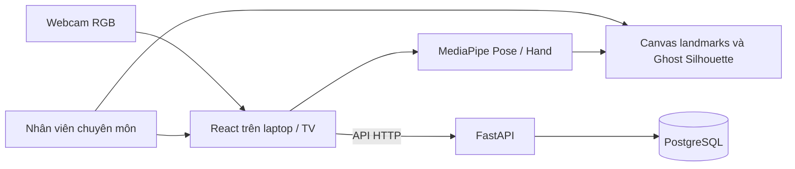

# Kiến trúc MVP phục hồi chức năng chi trên

## Phạm vi

Ứng dụng hỗ trợ nghiên cứu với mã bệnh nhân giả danh, phiên tập và hiệu chuẩn thủ công bằng hình bóng tham chiếu. Webcam RGB đặt giữa cạnh trên TV; laptop chạy ứng dụng và xuất hình lên TV. Hình bóng giúp nhân viên chuyên môn căn vị trí đầu, vai và thân, nhưng không phải công cụ tự xác nhận tư thế đạt chuẩn lâm sàng. Cần hiệu chuẩn lại khi ghế hoặc camera thay đổi.

Căn cứ phạm vi nghiên cứu: tài liệu `Rehabilitation - đề cương nghiên cứu - 26.10.docx` và sơ đồ pipeline do người yêu cầu cung cấp. Nội dung dưới đây phân biệt phần MVP với luồng dự kiến ở giai đoạn sau.

Frontend xử lý hình ảnh camera tại trình duyệt. Canvas phủ lên video; cấu hình hình bóng có tọa độ chuẩn hóa để phục vụ các kích thước hiển thị khác nhau. Trò Chạm hoa phát sáng dùng mốc cổ tay bên tập để nhận chạm, tạm dừng đồng hồ khi mất mốc và có thể lưu kết quả vào phiên đang thực hiện. API quản lý bệnh nhân, phiên, hiệu chuẩn và kết quả trò chơi; PostgreSQL là nguồn dữ liệu ứng dụng và không dùng SQLite. Chế độ demo dùng con trỏ mô phỏng, không ghi kết quả thành dữ liệu bệnh nhân.

## Luồng nghiên cứu dự kiến sau MVP

Sơ đồ đề cương mô tả camera tạo luồng mốc vận động qua MediaPipe và một nhánh video theo thời gian. Mốc được dùng cho trò chơi AR và đặc trưng chuyển động; kết quả bài tập, đặc trưng, video và đánh giá lâm sàng là các nguồn có thể đưa vào AI về sau. AI có thể hỗ trợ ước lượng mức suy giảm và đề xuất bài tập, với nhân viên chuyên môn xác nhận. MVP có trò Chạm hoa thử nghiệm; chưa triển khai dự đoán AI, cá nhân hóa bài tập hoặc ghi video.

Điểm FMA-UE do nhân viên chuyên môn đánh giá là nhãn tham chiếu, tối đa 66 điểm. Điểm trò chơi không phải FMA-UE. Không suy luận lực, sức cơ, co cứng hoặc đưa ra kết luận lâm sàng chỉ từ webcam. Video trong nghiên cứu tương lai chỉ được ghi khi có sự đồng ý và phải có biện pháp bảo vệ và kiểm soát truy cập.

Khi xây dựng thu thập chuỗi dữ liệu sau này, cần đồng bộ `frame_id`, `timestamp_ms`, `patient_id`, `session_id`, `trial_id` bằng đồng hồ đơn điệu, bảo toàn metadata, validity mask và đánh dấu khung bị mất. Cân nhắc lưu chuỗi dài trong Parquet hoặc định dạng phù hợp, giữ metadata/tham chiếu trong PostgreSQL; không mặc định ghi một hàng cho từng mốc ở từng khung.

## Ranh giới sử dụng

MVP này phục vụ phát triển và kiểm thử với dữ liệu giả lập. Không đưa dữ liệu cá nhân hoặc dữ liệu nghiên cứu thật vào hệ thống khi chưa có xác thực, phân quyền, bảo vệ lưu trữ, quy trình đồng ý và vận hành phù hợp. Không triển khai công khai API chưa có cơ chế kiểm soát truy cập.
